<!-- Generated by tools/build.mjs from tools/content.mjs. Edit content.mjs and run `npm run build` in tools/. -->
<a href="https://arturcastiel.github.io/">
  <picture><source media="(prefers-color-scheme: dark)" srcset="assets/banner-dark.svg"></picture>
</a>

I develop numerical methods and open&#8209;source simulators for flow in porous media, from **multiscale finite volumes on unstructured grids** to **local grid refinement in [OPM Flow](https://opm-project.org/)**, applied to hydrogen storage, CCS and geothermal energy. Contributor to [OPM](https://github.com/OPM) with 70+ merged pull requests and credited author of [OPM Flow 2026.04](https://doi.org/10.5281/zenodo.20504835).

<a href="mailto:artur.castiel@tno.nl"><picture><source media="(prefers-color-scheme: dark)" srcset="assets/pill-email-dark.svg"></picture></a>
<a href="https://arturcastiel.github.io/"><picture><source media="(prefers-color-scheme: dark)" srcset="assets/pill-website-dark.svg"></picture></a>
<a href="https://scholar.google.com/citations?user=dRY2EE8AAAAJ"><picture><source media="(prefers-color-scheme: dark)" srcset="assets/pill-scholar-dark.svg"></picture></a>
<a href="https://orcid.org/0000-0003-0722-7024"><picture><source media="(prefers-color-scheme: dark)" srcset="assets/pill-orcid-dark.svg"></picture></a>
<a href="https://www.researchgate.net/profile/Artur-Castiel"><picture><source media="(prefers-color-scheme: dark)" srcset="assets/pill-researchgate-dark.svg"></picture></a>
<a href="https://www.linkedin.com/in/arturcastiel/"><picture><source media="(prefers-color-scheme: dark)" srcset="assets/pill-linkedin-dark.svg"></picture></a>

<a href="https://arturcastiel.github.io/#about"><picture><source media="(prefers-color-scheme: dark)" srcset="assets/h-interests-dark.svg"></picture></a>

<a href="https://arturcastiel.github.io/#about"><picture><source media="(prefers-color-scheme: dark)" srcset="assets/interests-dark.svg"></picture></a>

<a href="https://arturcastiel.github.io/#publications"><picture><source media="(prefers-color-scheme: dark)" srcset="assets/h-publications-dark.svg"></picture></a>

<a href="https://doi.org/10.1016/j.compgeo.2026.107918"><picture><source media="(prefers-color-scheme: dark)" srcset="assets/pub-1-dark.svg"></picture></a>
<a href="https://doi.org/10.1016/j.jcp.2024.112759"><picture><source media="(prefers-color-scheme: dark)" srcset="assets/pub-2-dark.svg"></picture></a>
<a href="https://doi.org/10.1016/j.advwatres.2024.104679"><picture><source media="(prefers-color-scheme: dark)" srcset="assets/pub-3-dark.svg"></picture></a>
<a href="https://doi.org/10.1016/j.apm.2024.05.045"><picture><source media="(prefers-color-scheme: dark)" srcset="assets/pub-4-dark.svg"></picture></a>
<a href="https://doi.org/10.1016/j.apm.2021.11.017"><picture><source media="(prefers-color-scheme: dark)" srcset="assets/pub-5-dark.svg"></picture></a>
<a href="https://doi.org/10.1016/j.petrol.2019.106851"><picture><source media="(prefers-color-scheme: dark)" srcset="assets/pub-6-dark.svg"></picture></a>
<a href="https://scholar.google.com/citations?user=dRY2EE8AAAAJ"><picture><source media="(prefers-color-scheme: dark)" srcset="assets/pubs-more-dark.svg"></picture></a>

<a href="https://arturcastiel.github.io/#projects"><picture><source media="(prefers-color-scheme: dark)" srcset="assets/h-projects-dark.svg"></picture></a>

<a href="https://opm-project.org/"><picture><source media="(prefers-color-scheme: dark)" srcset="assets/card-opm-dark.svg"></picture></a><a href="https://gitlab.com/darsim/src"><picture><source media="(prefers-color-scheme: dark)" srcset="assets/card-darsim-dark.svg"></picture></a> 
<a href="https://github.com/padmec-reservoir"><picture><source media="(prefers-color-scheme: dark)" srcset="assets/card-impress-dark.svg"></picture></a><a href="https://scholar.google.com/citations?user=dRY2EE8AAAAJ"><picture><source media="(prefers-color-scheme: dark)" srcset="assets/card-metrics-dark.svg"></picture></a>

<a href="https://arturcastiel.github.io/#skills"><picture><source media="(prefers-color-scheme: dark)" srcset="assets/h-stack-dark.svg"></picture></a>

<a href="https://arturcastiel.github.io/#skills"><picture><source media="(prefers-color-scheme: dark)" srcset="assets/stack-dark.svg"></picture></a>

<a href="https://arturcastiel.github.io/#education"><picture><source media="(prefers-color-scheme: dark)" srcset="assets/h-education-dark.svg"></picture></a>

<a href="https://arturcastiel.github.io/#education"><picture><source media="(prefers-color-scheme: dark)" srcset="assets/education-dark.svg"></picture></a>

<a href="https://arturcastiel.github.io/#awards"><picture><source media="(prefers-color-scheme: dark)" srcset="assets/h-awards-dark.svg"></picture></a>

<a href="https://arturcastiel.github.io/#awards"><picture><source media="(prefers-color-scheme: dark)" srcset="assets/award-litpeg-dark.svg"></picture></a><a href="https://arturcastiel.github.io/#awards"><picture><source media="(prefers-color-scheme: dark)" srcset="assets/award-abmec-dark.svg"></picture></a>

